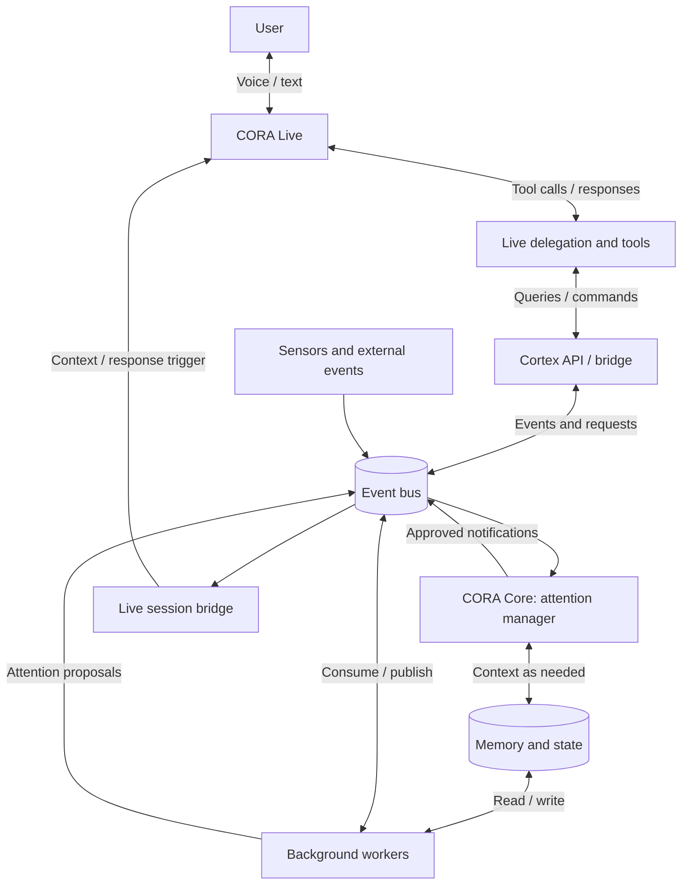
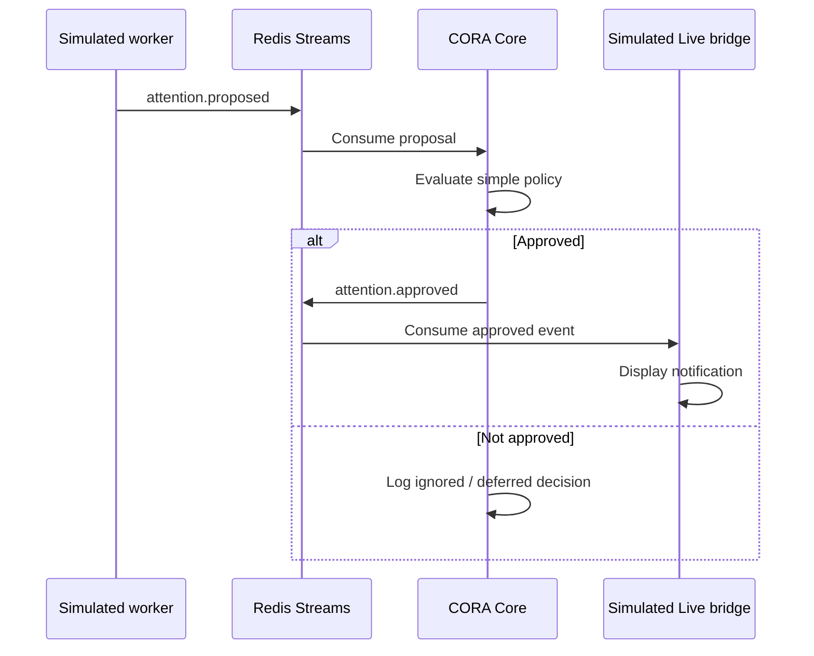

# CORA Cortex

**CORA** stands for **Conversation Oriented Relational Assistant**.

CORA Cortex is an event-driven cognitive architecture for a persistent, conversational AI assistant. It separates real-time interaction from background processing so CORA can maintain memory, observe events, explore interests, and decide when something is worth bringing into a conversation—without loading every capability into one model's context window.

> **Core idea:** CORA is a system that happens to speak. Live is the conversational interface; Cortex is the system operating around it.

This README has two parts:
1. **Target architecture** — the long-term design, reusable in the future `cora-cortex` repository.
2. **Proof of concept** — the deliberately small experiment to implement in `cora-cortex-poc` now.

---

## Part I — Target Architecture

### 1. Design goals

- **Keep Live lean.** The real-time voice model handles conversation, not every background concern.
- **Run independently.** Background services can work while Live is active, idle, disconnected, or asleep.
- **Communicate through events.** Producers and consumers should be loosely coupled.
- **Control attention.** Background services propose items; CORA Core decides whether, when, and how urgently they should reach Live.
- **Preserve conversational agency.** Core can propose a topic; Live decides how to express it in context. An explicit interruption policy governs whether a new response may be triggered.
- **Use the right model for the task.** Deterministic code where possible; lightweight models for classification; larger models for complex work.
- **Remember selectively.** Store durable information and retrieve relevant context on demand instead of injecting the entire history into every session.
- **Remain observable and recoverable.** Trace events, decisions, deliveries, retries, and failures.
- **Protect privacy and control.** Sensors, research, retention, and proactive interruptions are configurable and subject to user consent.

### 2. Conceptual components



The diagram shows logical responsibilities, not necessarily separate machines or containers. The Live bridge is application code that mediates between the event bus and the real-time API. It is **not** a direct connection into model internals.

### 3. CORA Live — conversation and presentation

Live handles low-latency speech/text interaction, conversational flow, and tool requests. It should receive **small, relevant notifications** from Cortex, not the full event stream. Live retains its delegation/tool pathway for requesting additional details or initiating tasks.

**Two directions of communication:**

- **Live → Cortex:** Live calls a tool or bridge API to request information, search memory, start research, or perform another permitted action.
- **Cortex → Live:** Core approves a proposal; the bridge queues or delivers concise context to the active Live session. Depending on the real-time API's supported behavior, the application may also request a response. Merely sending context does not guarantee spontaneous speech.

The bridge must account for session lifecycle, busy/speaking state, reconnects, deduplication, and interruptions. We must **verify actual API semantics experimentally**, rather than assume a mid-session system-message mechanism exists.

### 4. CORA Core — attention and coordination

Core is a **service**, not necessarily a permanently running LLM. Its first implementation can use deterministic rules; models can be invoked selectively later.

Core receives **attention proposals** from workers and decides to:

- **Surface now** — sufficiently important and appropriate to interrupt.
- **Queue for later** — relevant, but wait for a lull or the next session.
- **Store only** — useful for memory, not for immediate conversation.
- **Discard** — irrelevant, stale, duplicated, or low-value.

Potential decision signals: relevance, urgency, confidence, novelty, current conversation, user preferences, quiet hours, and whether Live is active or speaking. Decisions should be logged with reasons.

Core is the gatekeeper; **workers cannot directly force Live to speak**.

### 5. Event bus

An event bus decouples sensors, workers, Core, and the Live bridge. Redis Streams is the initial candidate; its consumer groups and acknowledgment behavior suit recoverable event processing.

Example event envelope (illustrative, not a final schema):

```json
{
  "event_id": "uuid",
  "event_type": "attention.proposed",
  "schema_version": 1,
  "source": "reflection-worker",
  "timestamp": "2026-10-14T12:00:00Z",
  "correlation_id": "uuid",
  "payload": {
    "summary": "Found a useful follow-up to an earlier discussion",
    "priority": "normal",
    "confidence": 0.85,
    "expires_at": "2026-10-15T12:00:00Z"
  }
}
```

Event names and schemas should be versioned. Consumers must tolerate at-least-once delivery through idempotency and deduplication; Redis Streams alone does not guarantee exactly-once processing. Define retention, retry, dead-letter, and sensitive-data policies before production.

### 6. Background workers

Workers are independently scheduled or event-driven processes. They do not all need to be AI agents.

| Future worker | Responsibility |
|---|---|
| Memory | Extract, store, retrieve, and consolidate useful information |
| Reflection | Review conversations and produce potential follow-ups |
| Interests | Track and explore evolving topics over time |
| Awareness | Interpret opt-in signals from cameras, microphones, presence, or applications |
| Research | Investigate questions and publish completed findings |
| Self-model | Maintain a bounded representation of CORA's ongoing preferences, goals, and state |
| Scheduler | Trigger periodic tasks and housekeeping |

Workers can publish observations, results, and **attention proposals**. Core controls what reaches Live.

### 7. Memory and persistent state

The intended memory layer can build on the original `cora` project's PostgreSQL/pgvector approach, subject to code review and migration needs. Distinguish conversation history, user facts, episodic memories, ongoing interests, and system/task state. Retrieve relevant items on demand and inject only a compact session summary when appropriate.

**Standby is not shutdown:** Live may disconnect to save real-time API costs while Cortex continues working. A wake-word or other explicit activation signal can reconnect Live. Any proactive wake-up must respect user settings.

### 8. Deployment and model routing

Start with Python 3.13, Docker Compose, and Redis. Introduce PostgreSQL when persistent memory/state is needed. Workers may use `asyncio` internally and run in separate containers for fault isolation. Model selection is a future policy concern, not a POC prerequisite. Safety and privacy rules apply regardless of which model handles a task.

---

## Part II — `cora-cortex-poc` (Current Project)

### 9. Purpose

**Prove that an independent background worker can publish an event, Core can decide whether it deserves attention, and a Live-facing interface can receive it without the worker talking to Live directly.**

This is an architectural experiment, **not** a rebuild of the original CORA application.

### 10. Strict POC scope

Implement only:

1. **Redis Streams** as the event transport, launched via Docker Compose.
2. **One producer/worker** that publishes a simulated background discovery or thought.
3. **CORA Core** as a consumer that evaluates attention proposals using simple, documented deterministic rules and emits approved notifications.
4. **A simulated Live terminal client** that receives approved notifications and displays them; optionally simulate `busy`, `idle`, and `offline` states.
5. **Structured logging** with event IDs and correlation IDs so a message can be traced end-to-end.

Use plain Python processes and a small number of modules. Avoid introducing FastAPI, Celery, PostgreSQL, vector databases, or an LLM unless a later experiment demonstrates a need.

### 11. Minimal event flow



**Suggested initial rule:** approve proposals with `priority = high`; defer `normal`; discard expired proposals. These rules are intentionally simplistic and must be easy to replace. If implementing deferred delivery, persist the queue or explicitly document that deferral is simulated.

### 12. Suggested repository layout

```text
cora-cortex-poc/
├── README.md
├── pyproject.toml
├── docker-compose.yml
├── .env.example
├── .gitignore
├── src/
│   └── cortex_poc/
│       ├── __init__.py
│       ├── events.py         # Shared event schema and serialization
│       ├── bus.py            # Redis Streams adapter
│       ├── producer.py       # Simulated background worker
│       ├── core.py           # Attention decisions
│       └── live_sim.py       # Simulated Live event consumer
└── tests/
    ├── test_events.py
    └── test_attention.py
```

This is a suggested structure, not a requirement to build unnecessary abstractions. Prefer explicit, readable code.

### 13. Acceptance criteria

The first POC is complete when:

- [ ] `docker compose up -d` starts Redis reliably.
- [ ] Producer, Core, and Live simulator can run as separate processes.
- [ ] Publishing a high-priority proposal causes exactly **one visible notification** in the Live simulator during a normal run.
- [ ] A rejected or expired proposal does not reach Live.
- [ ] Logs show the same event/correlation IDs from production through decision and delivery.
- [ ] Restarting Core after an event was published does not silently lose an unacknowledged proposal; pending-message recovery is tested.
- [ ] Reprocessing an event does not cause duplicate user-visible notifications in the tested restart scenario.
- [ ] The README documents startup commands, event schemas, and known limitations.

Redis consumer-group acknowledgment should happen **after** successful handling. Keep idempotency state sufficient for the tested recovery scenario; document that stronger durable guarantees would be needed for production.

### 14. Explicitly out of scope

Do **not** implement these in the initial POC:

- OpenAI Realtime/Live connection or voice output
- LLM-powered attention decisions
- Real cameras, microphones, wake words, or other sensors
- PostgreSQL, vector search, or memory migration
- Autonomous web browsing, research, or interests
- User interface beyond the terminal simulator
- Full deployment, authentication, or distributed scaling

### 15. Next experiment — real Live bridge

Once the simulated path works, make a **separate, narrow spike** that connects the approved-event stream to an actual OpenAI Realtime session. Confirm with the current API and SDK:

1. How to deliver contextual information during an active session.
2. Whether the application can explicitly trigger a response without user speech.
3. How to avoid speaking over the user or interrupting an active model response.
4. What happens when Live is disconnected, idle, or reconnecting.
5. Whether notification context can remain concise without contaminating subsequent turns.

Treat API behavior as **unverified until tested**. Do not assume that arbitrary system-message injection or autonomous speech is supported in a particular API configuration.

### 16. Later migration from original `cora`

Only after the event-to-Live bridge is proven, selectively reuse the original project's Live integration, delegation tools, memory/storage components, wake-word detection, and standby handling. Adapt interfaces rather than copying the entire monolithic application. Keep the original repository intact as a working reference.

### 17. Instructions for GitHub Copilot

**Implement Part II only, in small increments.** Use Part I as architectural context, not as a request to build every component. Start by scaffolding Redis, the event envelope, and a producer/consumer smoke test. Then implement deterministic Core decisions, then the Live simulator, then restart/recovery tests. Explain each increment before moving to the next. Prefer minimal dependencies, type hints, focused tests, and configuration through environment variables. Do not add an LLM, database, web framework, or real Live integration in the first milestone.

**First task:** Create the minimal project scaffold and demonstrate one JSON event being published to Redis Streams and read by a separate Python process. Stop there for review.
